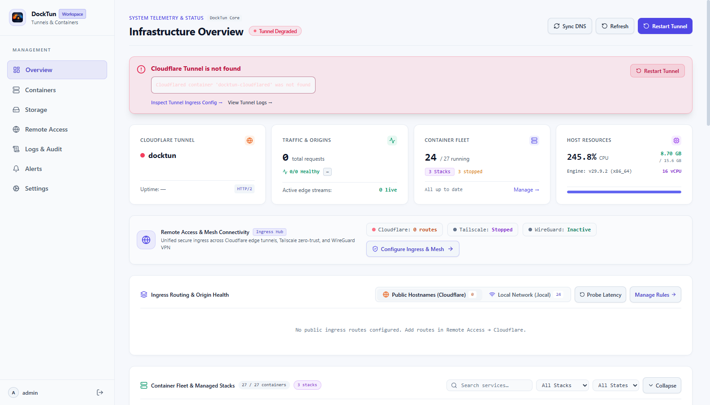
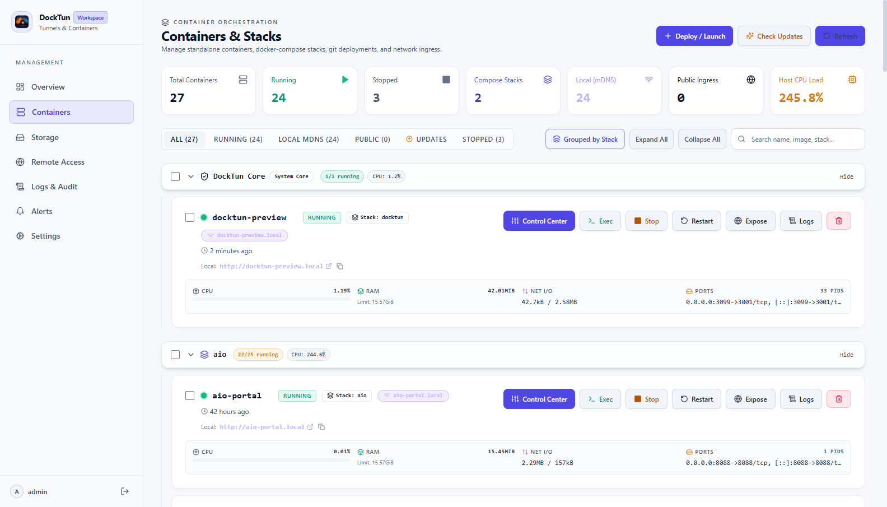
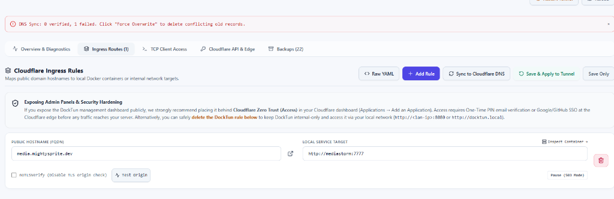
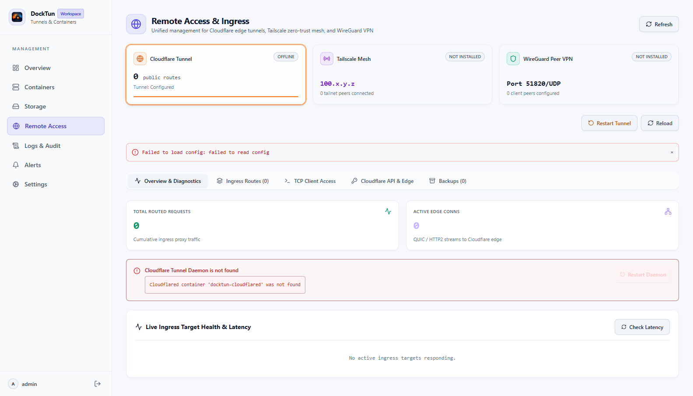
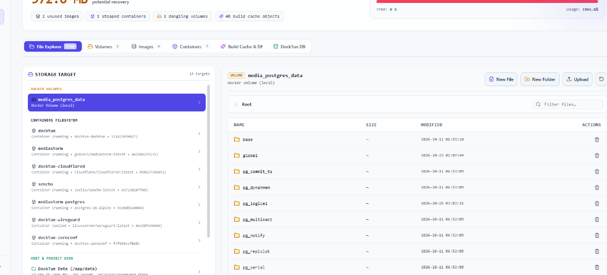

# ☁️ DockTun

Modern, self-hosted web dashboard for managing Docker containers and Compose stacks, with optional, independent per-container remote access (Cloudflare Tunnels, Tailscale, WireGuard, and local mDNS).


---

## Highlights

- 🐳 **Docker Container Management** — Start, stop, restart, pause, inspect, and delete containers. Live CPU, memory, and network I/O stats.
- 📦 **Docker Compose Projects** — Deploy and manage multi-container stacks with Git clone, branch checkout, pull, and streaming build logs.
- 🌐 **Independent Per-App Remote Access** — Expose containers individually without exposing your entire network:
  - **Cloudflare Tunnels**: Public ingress without open ports, visual YAML config editor with auto-backups, and Cloudflare DNS sync.
  - **Tailscale**: Connect each container as its own isolated Tailscale device (userspace mode, no host TUN or root privileges required).
  - **WireGuard**: Mesh connectivity via companion container or existing host VPN.
  - **Local mDNS**: Automatic local `.local` domain routing on your LAN.
- **Optional local reverse proxy**: Choose Caddy, Traefik, or Nginx under **Settings → Local Reverse Proxy**, add manual hostname-to-container routes, and apply. DockTun creates and uses the dedicated `docktun-proxy` network, connects selected containers, and manages one active proxy companion. Routes use container names and internal ports; no public DNS or Cloudflare credentials are required.
- 💻 **Web Terminal & Logs** — In-browser interactive `docker exec` terminal and real-time streaming WebSocket logs with filtering.
- 📁 **File & Volume Explorer** — Browse container filesystems, view and edit configuration files in-place, and upload or download files.
- 🔄 **Self-Healing & 1-Click Updates** — Automatic database companion network relinking, continuous health reconciliation, and 1-click self-updating with automated health-check rollback.
- 🔔 **Audit Trail & Alerts** — Full SQLite action history and webhook notifications for Discord, Telegram, and Slack.

---

## 📸 Interface Preview

<p align="center">
  
</p>

<details open>
<summary><b>Additional Views (Containers, Ingress Rules, Remote Access, File Explorer)</b></summary>
<br>

### 🐳 Container & Compose Stack Orchestration
> Real-time CPU, RAM, and network meters, stack grouping, in-browser terminal, and 1-click updates.

<p align="center">
  
</p>

### ☁️ Cloudflare Ingress Routing
> Visual ingress rule management, public domain mapping to internal container ports, and direct Cloudflare DNS synchronization.

<p align="center">
  
</p>

### 🌐 Multi-Provider Remote Access Hub
> Unified exposure manager supporting Cloudflare edge tunnels, Tailscale userspace devices, WireGuard VPN, and local mDNS.

<p align="center">
  
</p>

### 📁 Storage & Docker Volume Explorer
> Full container filesystem and Docker volume browsing with in-place file editing and uploads.

<p align="center">
  
</p>

</details>

---

## Architecture

DockTun compiles the Vue 3 frontend directly into a single, high-performance Go binary. There is no separate Nginx container or reverse-proxy dependency.

```
┌──────────────────────────────────────────────────────────────┐
│  DockTun (Unified Container)                                 │
│                                                              │
│  ┌────────────────────────┐      ┌────────────────────────┐  │
│  │  Vue 3 SPA (Embedded)  │ ───> │  Go Backend API (Chi)  │  │
│  └────────────────────────┘      └───────────┬────────────┘  │
│                                              │               │
│               ┌──────────────────────────────┼──────────┐    │
│               │                              │          │    │
│               ▼                              ▼          ▼    │
│       /var/run/docker.sock                SQLite    Dynamic  │
│      (Docker Daemon Control)             (app.db)  Companions│
└──────────────────────────────────────────────────────────────┘
```

---

## Quick Start

### Option 1: Automated installer

If your machine doesn't have Docker installed yet, or if you prefer a one-command setup, save the supplied `install.sh` locally and run it. The installer installs Docker Engine on supported Linux hosts if needed and launches DockTun:

```bash
sudo bash install.sh
```

The repository is private; share the installer file directly with testers. No source checkout or GitHub token is needed to pull the published image. On Synology, install Container Manager from Package Center first. Rerunning the installer keeps the existing Compose file, pulls the current image, and starts only DockTun; optional providers retain their current state.

### Option 2: Docker Compose (If Docker is already installed)

Save the following as `compose.yml` in an empty directory:

```yaml
services:
  docktun:
    image: ghcr.io/ooflyeyesoo/docktun:latest
    container_name: docktun
    restart: unless-stopped
    ports:
      - "8080:3001"
    environment:
      DOCKER_NETWORK: docktun
      TAILSCALE_STATE_VOLUME: docktun-tailscale-state
      WIREGUARD_PORT: 51820
      DB_PATH: /app/data/app.db
      CLOUDFLARED_CONFIG_PATH: /etc/cloudflared/config.yml
      CLOUDFLARED_CONTAINER: docktun-cloudflared
    volumes:
      - /var/run/docker.sock:/var/run/docker.sock
      - docktun-data:/app/data
      - docktun-cloudflared:/etc/cloudflared
      - docktun-wireguard:/app/data/wireguard
      - ./projects:/opt/projects
    networks:
      - docktun

volumes:
  docktun-data:
  docktun-cloudflared:
  docktun-wireguard:

networks:
  docktun:
    name: docktun
    driver: bridge
```

Start DockTun:

```bash
docker compose up -d
```

Open **`http://<your-server-ip>:8080`** in your browser.

#### First-Time Admin Account Setup

To create your administrator account on first launch, copy the ownership setup token from the container:

```bash
docker exec docktun cat /app/data/setup.token
```

Enter this token on the initial screen to set your administrator credentials. Alternatively, set `ADMIN_USERNAME` and `ADMIN_PASSWORD` in your Compose `environment` to configure credentials ahead of time.

> [!WARNING]
> DockTun mounts the Docker daemon socket (`/var/run/docker.sock`) to control containers, which grants broad host access. Always keep DockTun behind authenticated remote access or on a trusted local network. **Never expose port 8080 directly to the public internet without authentication.**

---

### Option 2: Docker Run

```bash
docker network create docktun 2>/dev/null || true

docker run -d \
  --name docktun \
  -p 8080:3001 \
  -v /var/run/docker.sock:/var/run/docker.sock \
  -v docktun-data:/app/data \
  -v docktun-cloudflared:/etc/cloudflared \
  -v docktun-wireguard:/app/data/wireguard \
  -v $(pwd)/projects:/opt/projects \
  --network docktun \
  --restart unless-stopped \
  ghcr.io/ooflyeyesoo/docktun:latest
```

---

### Option 3: Build from Source

```bash
git clone https://github.com/oOflyeyesOo/docktun.git /opt/docktun
cd /opt/docktun

docker compose up -d --build
```

---

## Remote Access & Exposure Providers

DockTun does not enforce a single global networking mode. Every container starts internal and isolated; choose remote access per app in **Containers → Access**:

- **Cloudflare Tunnel**: Enter your Cloudflare Tunnel connector token (or mount your existing `config.yml` and credentials) under **Remote Access → Cloudflare**, then click **Enable**. The connector token runs the tunnel. To publish Cloudflare-managed app routes from DockTun, save an API token with account **Cloudflare Tunnel Edit/Write** and zone **DNS Edit/Write** permissions. **Enter the domain's Zone ID under API credentials so the token does not need Zone Read.** Copy it from the domain's **Overview → API → Zone ID**; it is different from Account ID. Zone Read is only needed for automatic discovery when no Zone ID is saved. **Account DNS Settings Write** is a different permission and does not grant access to zone DNS records. Both account-owned and user-owned API tokens can work with the correct scopes; Write on Cloudflare's summary means Edit in its token builder. The Cloudflare page includes the full setup steps. Routes managed directly in Cloudflare do not require an API token in DockTun.
- **Tailscale**: Connect any container with 1-click in the container's **Access** tab. DockTun spawns a dedicated userspace Tailscale helper for that app, creating a separate device identity and MagicDNS hostname on your tailnet without touching the host's networking stack.
- **WireGuard**: Configure an existing WireGuard VPN address or use the companion container.
- **Internal / mDNS**: Keeps containers internal, accessible via LAN or local `.local` addresses.

### Local Reverse Proxy

The local proxy is disabled by default. When enabled, the selected engine listens on the configured HTTP/HTTPS host ports and routes only the enabled entries configured in **Settings → Local Reverse Proxy**. Use a hostname resolvable on your LAN (for example through local DNS or a hosts entry), and use the container/service name plus its internal listening port. DockTun validates target containers, creates `docktun-proxy`, connects targets to it, and writes the selected engine's generated configuration. Disable the feature to stop and remove the managed proxy companion.

---

## Updating DockTun

- **From the Web UI**: Open **Settings → DockTun services**, check for updates, select the installed services, and choose **Update selected**. This covers the core, local proxy, managed Cloudflare/Tailscale/WireGuard companions and per-app Tailscale helpers. Companions update one at a time and the core updates last using an independent worker. Stopped services stay stopped; missing providers are configured separately under Exposure providers. Existing mounts, settings, network aliases and device state volumes are retained. A failed replacement restores that service’s previous container and stops the batch; earlier successful updates remain installed. Container rollback does not reverse application-data migrations.
- **Via Docker Compose**:
  ```bash
  docker compose pull
  docker compose up -d
  ```

---

## Environment Variables

| Variable | Description | Default |
|----------|-------------|---------|
| `PORT` | Host port to publish | `8080` |
| `LISTEN_ADDR` | Internal listen address | `0.0.0.0:3001` |
| `JWT_SECRET` | Secret key for JWT session signing | Auto-generated in `app.db` |
| `ADMIN_USERNAME` | Default admin username (pre-seeding) | `admin` |
| `ADMIN_PASSWORD` | Default admin password (pre-seeding) | Generated via `setup.token` |
| `DOCKER_NETWORK` | Bridge network name | `docktun` |
| `DB_PATH` | Path to persistent SQLite database | `/app/data/app.db` |
| `CLOUDFLARED_CONFIG_PATH` | Cloudflare config file path | `/etc/cloudflared/config.yml` |
| `CLOUDFLARED_CONTAINER` | Cloudflared container name | `docktun-cloudflared` |
| `TAILSCALE_STATE_VOLUME` | Named Docker volume for Tailscale state | `docktun-tailscale-state` |
| `SELF_PATH` | Host path for self-updates | `/opt/projects/docktun` |

---

## Development

```bash
# Backend (Go 1.25+)
cd backend
go mod tidy
go run ./cmd/server

# Frontend (Node 20+ / pnpm)
cd frontend
pnpm install
pnpm run dev
```

---

## License

MIT License. See [LICENSE](LICENSE) for details.

### Local `.local` links

Portless `http://app.local` links require the `zeroconf` service in the current Compose file. For an existing prebuilt installation, download the updated `compose.prebuilt.yml`, retain your existing volume/project settings, then run `docker compose -f compose.prebuilt.yml up -d --pull always docktun zeroconf`. Updating only the DockTun container does not add or recreate this separate service.

The proxy uses Linux host networking and host TCP port 80. Check `docker logs docktun-zeroconf` if names resolve but pages fail. A Synology web server or another proxy may already occupy port 80; arrange the existing LAN reverse proxy to serve these hostnames or free that port before using portless links. Keep direct LAN IP and published-port URLs available as a fallback. mDNS clients must be on a network that passes local multicast. On hosts with multiple interfaces, set `HOST_IP` in the zeroconf service to the Docker host's LAN address. These links do not enable a remote tunnel.
